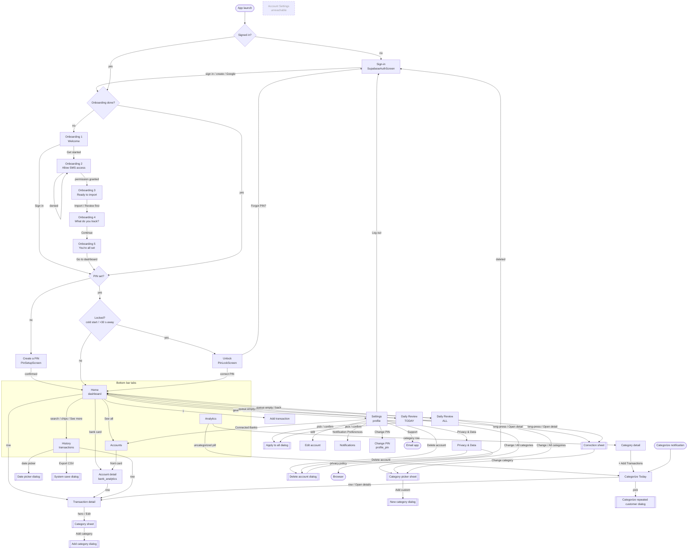

# Kash (Android) — UI inventory

Snapshot of the app as of **1.0.0 (versionCode 20), 27 Oct 2026**, read from the source. No code was changed. **Updated the same day** with the 4-digit app PIN (§2.20–2.22, §3.8). Strings are quoted exactly as they appear in code. Paths are relative to `app/src/main/java/com/financeapp/`.

---

## 1. Stack and structure

| Area | What's used | Where |
|---|---|---|
| UI framework | Jetpack Compose (Material 3, dark-only `FinanceAppTheme`) | `ui/theme/Theme.kt` |
| Navigation | Navigation-Compose `NavHost`, string routes, no transition animations ("hard-cut") | `ui/navigation/AppNavigation.kt` |
| Entry | Single activity `MainActivity` → `AppNavigation(...)` | `MainActivity.kt` |
| Screens | One file per screen | `ui/screens/*.kt` |
| Dialogs | `AlertDialog` composables inside the screen that owns them | same files |
| Bottom sheets | Custom (full-screen scrim + bottom card), not `ModalBottomSheet` | `ui/components/ReviewSheets.kt`, `ui/screens/TransactionDetailScreen.kt` |
| Shared components | | `ui/components/*.kt` |
| Theme tokens | Colors, type, category colors, press-scale + haptics | `ui/theme/Color.kt`, `Type.kt`, `CategoryColors.kt`, `Interactions.kt` |
| State | `ViewModel` + `StateFlow`, Room flows | `viewmodel/*.kt`, `data/` |

Many screens also define their own **local** color constants (`CardBg = 0xFF231E1A`, `InnerDark = 0xFF15110F`, `FooterGrey = 0xFF7C7872`…) instead of using theme tokens.

**Top-level gating** (`AppNavigation`, before any route):
1. Not signed in to Supabase → `SupabaseAuthScreen(onboardingMode = true)` (no NavHost).
2. Signed in but onboarding not complete → `OnboardingScreen` (no NavHost).
3. Otherwise → `MainNavigation` (the `NavHost` + floating bottom bar).

**Routes** (`Screen` sealed class + string routes):

| Route | Composable | Bottom bar |
|---|---|---|
| `dashboard` (start) | `DashboardScreen` | ✅ |
| `accounts` | `AccountsScreen` | ✅ |
| `transactions?search={search}` | `TransactionsScreen` | ✅ |
| `analytics` | `AnalyticsScreen` | ✅ |
| `categorize_today` | `CategorizeTransactionsScreen` | ✅ |
| `bank_analytics/{bankName}` | `BankAnalyticsScreen` | ❌ |
| `detail/{txId}` | `TransactionDetailScreen` | ❌ |
| `category_detail/{category}` | `CategoryDetailScreen` | ❌ |
| `daily_review` and `daily_review?scope={scope}` | `ReviewQueueScreen` | ❌ |
| `add_transaction` | `AddTransactionScreen` | ❌ |
| `profile` | `SettingsScreen` | ❌ |
| `profile_edit` | `EditAccountScreen` | ❌ |
| `profile_security` | `AccountSecurityScreen` (shows "Privacy & Data") | ❌ |
| `profile_notifications` | `NotificationPreferencesScreen` | ❌ |
| `account_settings` | `AccountSettingsScreen` | ❌ (unreachable) |

**Bottom bar** (`FloatingBottomNav`): floating 84 dp card, 4 icon-only tabs in this order: **Home** (`ic_home_dark`), **Accounts** (`ic_book_dark`), **History** (`ic_history_dark`), **Analytics** (`ic_anaytics_dark`). Content descriptions = labels. Selected tab tinted mint `AppBlue`, others `#B7B3AC`. A 140 dp fade scrim sits behind it. Tapping History clears History filters; tapping Analytics clears its search. Tabs pop to the start destination (no saved state).

---

## 2. Every screen, dialog and bottom sheet

### 2.1 Sign-in — `SupabaseAuthScreen`
- **File:** `ui/screens/SupabaseAuthScreen.kt` · **Route:** none (top-level gate).
- **Purpose:** create or sign into the cloud account; required before anything else.
- **Entry:** first launch; after "Log out"; after a session dies during sync (`markSessionExpired`).
- **Exits:** successful sign-in/sign-up → app re-gates to Onboarding (first time) or Home.
- **Sections (top → bottom):**
  - Top app bar title: `"Step 1 of 3"` (onboarding mode) / `"Cloud Sign-In"`. Back arrow only when `showBackButton` (never true in practice).
  - Card → eyebrow chip `"1. SIGN UP OR SIGN IN"` / `"SUPABASE ACCESS"`.
  - Title: `"Create your cloud space"` / `"Sign in to sync"` / `"You’re signed in"`.
  - Body: `"Use email and password or Google. This secures your sync before we ask for SMS access."` (onboarding) / `"Use your Supabase Auth email and password. The app only writes with your authenticated session."`; when signed in `"Signed in as {email}"` or `"Your sync session is active."`
  - `Email` field; `Password` field with eye toggle (`"Show password"` / `"Hide password"`).
  - Helper/error line: default `"You can create a new account here too. Next comes SMS access, then a quick finance wrapped."` (onboarding) / `"Email/password auth is required before cloud sync starts."`
  - **Sign in** button (shows spinner + `"Signing in"`).
  - **Sign in with Google** outlined button (toast `"Starting Google Sign-In..."`).
  - `"Need an account?"` + **Create one** text button — signs up **immediately** with the typed email/password (no separate form).
  - When already signed in: **Sign out** button (toast `"Signed out"`).
- **States / exact text:**
  - Validation: `"Email and password are required."`, `"Enter a valid email address."`, `"Password must be at least 6 characters."`
  - Session expired: `"You were signed out because your session expired. Sign in again to keep syncing."`
  - Errors (`friendlyAuthError`): `"No internet connection. Check your connection and try again."`, `"Wrong email or password."`, `"An account with this email already exists. Try signing in instead."`, `"Please confirm your email first — check your inbox."`, `"Password must be at least 6 characters."`, `"That email address doesn't look right."`, `"Too many attempts. Wait a minute and try again."`, `"Our server is having trouble. Please try again in a moment."`, fallbacks `"Sign-in failed. Please try again."` / `"Sign-up failed. Please try again."` / `"Google sign-in failed. Please try again."`
  - Google: `"Sign-in cancelled"`, `"No Google account found on this phone. Add one in Settings → Accounts, or sign in with email."`, `"Google sign-in isn't available right now. Please use email instead."`, `"Couldn't open Google sign-in. Please try again."`
  - Config missing: `"Sign-in isn't available in this version of the app."`
  - Success toasts: `"Signed in"`, `"Signed in with Google"`, `"Account created and signed in"`, `"Account created. Check your email to confirm, then sign in."`
- **Bottom bar:** no.

### 2.2 Onboarding — `OnboardingScreen` (5 internal steps, one composable)
- **File:** `ui/screens/OnboardingScreen.kt` · **Route:** none (top-level gate) · **Bottom bar:** no.
- **Purpose:** first-run pitch, SMS permission, import summary, setup.
- **Entry:** signed in and `onboardingComplete == false`. Step index is `rememberSaveable` (no back button between steps; system Back is not handled).

**Step 1 — `WelcomeStep`**
- Headline `"Tracking\nyour finance\nshouldn't feel like\nhomework"`.
- Body `"We help you track your finances\nwith out asking you to write down\nyour expenses daily"`.
- Card: shield icon, `"Private & Secure"`, `"Only bank messages are read.\nYour data is never sold or shared."`
- **Get started** (coral pill) → step 2.
- **Sign in** (dark pill) → **finishes onboarding immediately** (user is already signed in).
- Footer `"DESIGNED FOR PRIVACY  ·  BANK SMS ONLY"`.

**Step 2 — `SmsAccessStep`**
- Message icon, title `"Allow SMS access"`, body `"We read messages from banks and mobile money\nonly, and sync your transactions to your\naccount so they're on the web too."`
- Three benefit cards: `"detect transaction messages"` / `"Our system scans only for\nincoming bank and merchant\ntransaction alerts."`; `"auto-import spending"` / `"Every purchase is automatically\ncategorized, keeping your budget\nupdated in real-time."`; `"reduce manual entry"` / `"Stop typing in every coffee and\ngrocery bill. Let our atelier handle\nthe paperwork."`
- **Allow Access** → system permission dialog for `READ_SMS`, `RECEIVE_SMS` (+ `POST_NOTIFICATIONS` on Android 13+). Granted → starts SMS scan and auto-advances to step 3.
- Footer caption as above.
- **Denied:** nothing is shown; the screen stays on step 2. If the user chose "Don't ask again", tapping Allow does nothing (dead end).

**Step 3 — `ReadyToImportStep`**
- `"Ready to import"`, `"We've successfully analyzed your\nSMS records. Here's what we found across\nyour accounts."`
- Big number (live count of imported transactions) + `"TRANSACTIONS DETECTED"` + chip `"📅 Last 18 months"`.
- `"Detected Sources"` + `"{n} ACTIVE"`; up to 4 bank rows (name + first account number) each with a toggle (default on).
- Sticky: **Import transactions →** and **Review first** — both go to step 4.

**Step 4 — `CategoriesStep`**
- `"What do you track?"`, `"Select the categories most relevant to\nyour daily spending."`
- `"Select Categories"` + `"{n} SELECTED"`; rows with toggles: Food `"Dining, groceries, snacks"`, Transport `"Commute, fuel, repairs"`, Bills `"Rent, utilities, taxes"`, Airtime `"Data, call credit, sub"` (first three on).
- **Continue →** → step 5.

**Step 5 — `AllSetStep`**
- `"You're all set!"`; subtitle `"Here's a first look at what we found\nin your bank messages."` or (none imported) `"We didn't find any bank messages yet.\nNew ones will show up automatically."`
- Empty card (0 transactions): `"Nothing imported yet"` / `"Kash reads SMS from supported banks and Telebirr. As soon as one arrives, it appears on your dashboard. You can also add a transaction by hand with the + button."`
- `"Activity overview"` — count + `"Transactions\nimported"` (if > 0).
- `"Frequent Merchant"` — `{name}` + `"is your Biggest\nmerchant:"` (if any spending).
- `"Monthly Lifestyle"` — 6-bar chart + `"You've Spent\n{avg} in average\nevery month"` (if any spending).
- **Go to dashboard →** → sets onboarding complete → Home.

### 2.3 Home — `DashboardScreen`
- **File:** `ui/screens/DashboardScreen.kt` · **Route:** `dashboard` · **Bottom bar:** yes.
- **Purpose:** balance at a glance, today's review, banks, recent activity.
- **Entry:** app start; Home tab; Back from most screens.
- **Sections:**
  1. Header: greeting `"Good morning"` / `"Good afternoon"` / `"Good evening"`; name or `"Welcome"`. Coral **+** tile → `add_transaction`. Gear tile (`"Settings"`) → `profile`.
  2. **Total Balance** card (coral): `"Total Balance"`, `"ETB ••••••"` (hidden by default every launch) / `"ETB {total}"`, `"All accounts"`. Eye button (`"Show balance"` / `"Hide balance"`) toggles. Weekly bar chart S M T W T F S (Sun-start, this week; today's bar white, future days blank).
  3. **DailyReviewCard** (see §4).
  4. **Banks** (only if any accounts): `"Banks"` + `"See all"` (only if > 2 banks → `accounts`); up to 2 `BankCard`s (name, `{balance} ETB`) → `bank_analytics/{bank}`.
  5. History block: `"Transactions"` / `"History"`; a **fake search field** `"Search by name, bank, date ..."` (tap → History tab, nothing typed); chips **ALL · CREDITED · DEBIT · UNKNOWN** → History tab pre-filtered by type.
  6. Up to 3 day groups from the 40 most recent transactions: title `"Today"` / `"Yesterday"` / weekday name (e.g. `"Monday"`); `"{n} transactions"`; `"Net"` ±amount; rows (→ `detail/{id}`).
  7. **See more →** row → History tab.
- **States:** loading → centered spinner; no transactions → `"No transactions yet. Once messages are imported, your activity will appear here."`; pull-to-refresh → re-runs the SMS scan.

### 2.4 Accounts — `AccountsScreen`
- **File:** `ui/screens/AccountsScreen.kt` · **Route:** `accounts` · **Bottom bar:** yes.
- **Purpose:** all detected accounts as a stacked card deck.
- **Entry:** Accounts tab; Home "See all"; Settings → Connected Banks.
- **Sections:** header `"Sources"` / `"Accounts"` + profile icon (**not tappable**); card deck (cards overlap 80 dp). Front card: balance, bank logo (CBE, Telebirr, BoA have logos; others show the first letter), bank name, `"Account - {number}"`, `"{n} transactions Tracked"`. Back cards: balance + logo only.
- **Gestures:** tap front card → `bank_analytics/{bank}`; tap a back card → brings it to front; drag front card down → cycles to the next.
- **States:** empty → `"No accounts detected yet.\nImport SMS messages to see them here."` No loading state (uses Home's view model).

### 2.5 Account detail — `BankAnalyticsScreen`
- **File:** `ui/screens/BankAnalyticsScreen.kt` · **Route:** `bank_analytics/{bankName}` · **Bottom bar:** no.
- **Purpose:** one account's balance and transactions, searchable.
- **Entry:** Home bank card; Accounts deck.
- **Sections:** header `"‹ Sources"` (back) / `"Accounts"` + profile icon (**not tappable**); balance card (balance, logo, bank name, `"Account - {n}"`, `"{n} transactions Tracked"`); `"Recent Activities"` + `"Net"` (whole filtered set); search `"Search this account ..."` with ✕; period chips **1W · 1M · 1Y · All time**; rows (8, then **Load more...** +10) → `detail/{id}`.
- **States:** loading spinner; `"No activity recorded for this account."`; filtered empty `"No transactions match this search or period."`

### 2.6 History — `TransactionsScreen`
- **File:** `ui/screens/TransactionsScreen.kt` · **Route:** `transactions?search=` · **Bottom bar:** yes.
- **Purpose:** full history with search, type and period filters, export.
- **Entry:** History tab; Home search/chips/See more.
- **Sections:** header greeting + always `"Welcome"` (name not passed) + profile icon (**not tappable**). Card: `"Transactions"` / `"History"`; calendar tile (`"Pick date"`) → date picker dialog (**Apply** / **Cancel**) filtering to one day; download tile (`"Export CSV"`) → system save dialog, file `finance_transactions_{yyyyMMdd_HHmm}.csv`; search `"Search by name, bank, category ..."` with ✕; type chips **ALL · CREDITED · DEBIT · UNKNOWN**; period chips **1W · 1M · 1Y · All time**. Day groups `"Today"` / `"Yesterday"` / `"{Weekday}, {d MMM}"`, `"{n} transactions"`, `"Net"`. Rows → `detail/{id}`. **Load more...** (+10 days, only when no search/period filter).
- **States:** empty/no match `"No transactions match this view."` (also shown briefly while loading — no loading state); export toasts `"Exported {n} transactions"` / `"CSV export failed"`; pull-to-refresh → SMS scan.

### 2.7 Transaction detail — `TransactionDetailScreen`
- **File:** `ui/screens/TransactionDetailScreen.kt` · **Route:** `detail/{txId}` · **Bottom bar:** no.
- **Purpose:** everything about one transaction; change category, open receipt, share.
- **Entry:** any transaction row (Home, History, Account detail, Categorize Today).
- **Sections:** back + `"Transaction Details"`; hero card (tappable → category sheet): `CategoryPillBold` (category, or the **type label** `"Expense"` / `"Income"` / `"Transfer"` / `"Payment"` / `"Unknown"` if uncategorized) + `"Edit ›"`, `"{amount} ETB"`, bank name, account number. Details card (only rows with data): `"Receiver"`/`"Sender"`, `"Your account"`, `"Reference Num"`, `"Date & time"` (respects calendar setting), `"Balance after expense"`/`"Balance after income"`, `"Service charge"`, `"VAT"`, `"Disaster fund"`, `"Total charge"`. Then **Open receipt** + round **Share** (or full-width **Share transaction** if no receipt). **Show original SMS** / **Hide original SMS** → raw SMS block.
- **Category sheet (dialog-like):** scrim + card `"Category"` + `CategorySelector` (dropdown `"Select category"`, item `"Add category"` → dialog `"Add category"`, placeholder `"Gym payment"`, **Save** / **Cancel**).
- **States:** while loading the row nothing renders (blank screen). Toasts `"Couldn't open receipt link"`, `"Couldn't open share sheet"`. Share text: `"Paid/Received {amount} ETB to/from {name} via {bank}\n{date}\nRef: …\nReceipt: …"` (no balance).

### 2.8 Daily Review — `ReviewQueueScreen`
- **File:** `ui/screens/ReviewQueueScreen.kt` · **Route:** `daily_review` (scope TODAY) or `daily_review?scope=all` (scope ALL) · **Bottom bar:** no.
- **Purpose:** swipe through PENDING transactions and confirm a category for each.
- **Entry:** Home review card (today or older).
- **Sections:**
  - Header: `‹` back; eyebrow `"Daily Review"` + `"{Weekday} · {date}"` (calendar-aware) — or for ALL: `"Review queue"` + `"{n} older pending"`; segmented progress; `"{done} of {total} reviewed"` · `"{left} left · ~{eta}"` (ETA ≈ 6 s per item).
  - Card stack (up to 2 ghost cards behind). Active card: source pill (`CBE`/`Telebirr`/`BOA`/`Awash`/`Dashen`/name), `"SMS · {time}"` (date + time when calendar is Ethiopian), `"INCOME"`/`"EXPENSE"` chip, big `+`/`−` amount + `"ETB"`, `"From"`/`"To"` + name (or `"Unknown merchant"`).
  - Suggestion strip: glyph, `"Likely"` or `"Needs review"`, category or `"Uncategorized"`, **Change** → picker sheet.
  - Confidence dots + `"{n}% confidence"` (when ≥ 50%).
  - Flag banners: **"Looks like a transfer"** — `"{name} appears to match your own account. Marking as Transfer prevents fake spending."` CTA **Mark as transfer**; **"Low-confidence parse"** — `"We couldn't pick a category cleanly. Tap to verify the raw SMS, then pick one."` CTA **Open detail**.
  - `"▼ Show raw SMS"` / `"▲ Hide raw SMS"`.
  - Quick chips: **Food · Transport · Bills · Shopping · Transfer · Other** + **All categories** → picker sheet.
  - Action bar: **⏭ Skip** and **✓ Confirm** (or **✓ Save** when there is no prediction).
- **Gestures:** swipe right = confirm (overlay `"CONFIRM"`), swipe left = skip (`"SKIP"`); long-press → correction sheet.
- **Dialog — apply to all:** title `"Categorize all transactions with {name}?"`, body `"Found {n} transactions with this name.\n\n'Apply to all' will set every one of them — including any you've already categorized differently — to {category}, and remember the rule so future {name} transactions auto-categorize.\n\n'Just this one' only categorizes this row."`, buttons **Apply to all** / **Just this one**. Shown whenever the merchant has > 1 transaction.
- **Snackbar** (with **Undo**): `"Confirmed as {c}"`, `"Changed to {c}"`, `"Applied {c} to {n} {name} transactions"`, `"Skipped — we'll ask again tomorrow"` (TODAY) / `"Skipped — we'll resurface this later"` (ALL), `"Marked as not a transaction"`.
- **States:** `"Loading review queue…"`; empty `"All caught up"` / `"Every transaction reviewed for today."`; auto-closes back to Home when the queue empties (after the snackbar).

### 2.9 Category picker sheet — `CategoryPickerSheet` (Daily Review)
- **File:** `ui/components/ReviewSheets.kt`. Opened by **Change**, **All categories**.
- Grabber; `"Categorize"` + merchant name; ✕ close; search `"🔍 Search categories"`; sections **Recent** (falls back to Food, Transport, Transfer), **Common** (Food, Transport, Bills, Shopping, Health, Coffee and refreshments), **Lifestyle** (Drinks and fun, Entertainment, Rent, Fees, Loan), **Money in/out** (Transfer, Own accounts, Income, Other), **Custom**; row **+ Add custom category** / `Add "{query}"` with caption `"income · expense · neutral"`; toggle `"Apply to similar transactions"` / `"Updates rule for {firstWord}"`.
- **New category dialog:** `"New category"`, `"Pick a short, descriptive name. Used to group your transactions."`, field `"e.g. Subscriptions"`, error `"A category with that name already exists."`, **Create** / **Cancel**.

### 2.10 Correction sheet — `CorrectionSheet` (Daily Review long-press, "Open detail")
- `"Edit transaction"`; `"Amount"` ±amount `"ETB"`; rows `"Merchant"`, `"Source"`, `"Time"`, `"Category"` + `"Change ›"`; `"Raw SMS"` block; buttons **Not a transaction** and **Change category**; ✕.

### 2.11 Categorize Today — `CategorizeTransactionsScreen`
- **File:** `ui/screens/CategorizeTransactionsScreen.kt` · **Route:** `categorize_today` · **Bottom bar:** yes.
- **Purpose:** older list-style categorizer for today's uncategorized transactions.
- **Entry:** "Categorize today's transactions" notification; Analytics uncategorized pill; Category detail **+ Add Transactions**.
- **Sections:** top bar `"Categorize Today"` + back; card `"Hey {name|there}, let's sort today's spending."` + `"Everything for today is already categorized."` / `"You have 1 transaction waiting for a category."` / `"You have {n} transactions waiting for a category."`; per transaction: `TransactionItem` row, `CategorySelector`, **Open details** → `detail/{id}`.
- **Dialog:** `"Categorize repeated customer?"` — `"You've sent {total} to {name} in {n} transactions. Should I categorize all of them as {category}?"` — **Categorize all** / **Only this one**.
- **States:** empty `"You're all caught up for today."`

### 2.12 Analytics — `AnalyticsScreen`
- **File:** `ui/screens/AnalyticsScreen.kt` · **Route:** `analytics` · **Bottom bar:** yes.
- **Purpose:** this month's spending insights.
- **Sections:** greeting + always `"Welcome"` + profile icon (**not tappable**); `"Todays Spending"` `"ETB {x}"` `"{n} transactions today"`; `"This Months spending"` `"ETB {x}"` + S–S header + 5×7 heatmap + `"Top category: {c|—}"`; `"Spending"` `"AVG {x} per day"` + 7-bar chart; donut (or `"Categorise transactions to see the breakdown"`); `"Total spend by Category"` + `"This month"` + rows (emoji icon, name, `"- {x}"` or `"—"`) → `category_detail/{c}`; pill `"i {n} uncategorized transactions ›"` → `categorize_today`.
- **States:** no loading/empty state beyond the donut text.

### 2.13 Category detail — `CategoryDetailScreen`
- **File:** `ui/screens/CategoryDetailScreen.kt` · **Route:** `category_detail/{category}` · **Bottom bar:** no.
- **Sections:** back, `"{Category} Spending"`, `"30-Day View"`, calendar icon (**not tappable**); hero: emoji, `"Total monthly expenditure"`, `"{x} ETB"`, `"↑ {p}% of total spend"`; tiles `"Todays spend"`, `"Average daily spend"`; `"Recent History"` + day groups (rows **not tappable**); **+ Add Transactions** → `categorize_today`.
- **States:** `"No activity recorded for this category yet."`

### 2.14 Add transaction — `AddTransactionScreen`
- **File:** `ui/screens/AddTransactionScreen.kt` · **Route:** `add_transaction` · **Bottom bar:** no.
- **Sections:** back + `"Add transaction"`; segments **Expense · Income · Transfer**; `"Amount"` `"ETB "` field (placeholder `"0.00"`); `"To"`/`"From"` (`"Who paid / who got paid"`); `"Account / Bank"` (`"Cash, CBE, Telebirr…"`); `"Date"` (`EEE, MMM d • HH:mm`, date picker only — time not editable) 📅; `"Category (optional)"` chips: Food, Coffee and refreshments, Internet, Transport, Rent, Salary, Loan, Internal transfer, Other; `"Note"` (`"Optional"`); **Save transaction** / `"Saving…"` (disabled until amount > 0, name and bank filled).
- **States:** toast `"Transaction added"` then closes; error toast with the exception message or `"Could not save — try again"`.

### 2.15 Settings — `SettingsScreen`
- **File:** `ui/screens/SettingsScreen.kt` · **Route:** `profile` · **Bottom bar:** no · **No back button** (system Back only).
- **Sections:** profile card: ✏ (`"Edit profile"`) → `profile_edit`, avatar, name or `"Your Account"`, email or `"Not signed in"`; `"Preferences"`; rows **Privacy & Data** `"How your data is handled"` → `profile_security`; **Notification Preferences** `"Transaction alerts"` → `profile_notifications`; **Change PIN** `"4-digit PIN to open Kash"` → `profile_pin`; **Connected Banks** `"{n} External Account(s) Linked"` → `accounts`; **Support** `"Email us — we usually reply within a day"` → email app; **Calendar** `"Gregorian (Jan, Feb…)"` / `"Ethiopian (Meskerem, Tikimt…)"` with **GR / ET** toggle; **Log out** pill; **Delete account** link.
- **Delete dialog:** `"Delete your account?"`, `"This permanently deletes your Kash account and all of your synced transactions, categories and settings from our servers, and clears them from this phone.\n\nYour bank SMS messages are not touched. This can't be undone."`, **Cancel** / **Delete permanently** (spinner). Toasts `"Your account was deleted"`, `"No internet connection. Nothing was deleted — try again when you're online."`, `"Couldn't delete your account. Nothing was deleted — please try again or contact Support."`
- Support email: subject `"Kash support"`, body with app version/device/Android; no email app → toast `"No email app found. Write to us at {address}"`.

### 2.16 Edit account — `EditAccountScreen` (`profile_edit`)
Back; avatar; `"NAME"` field (`"Your name"`); `"EMAIL ADDRESS"` (read-only); **Save Changes** (disabled until the name changes) → saves and goes back.

### 2.17 Privacy & Data — `AccountSecurityScreen` (`profile_security`)
Compact profile header; back; `"How your data is handled"`; facts **Only bank messages**, **Synced to your account**, **Who can see it**, **On this phone** (text in code); **Read the privacy policy** → opens `https://finance-dashboard-two-virid.vercel.app/privacy.html`; **Delete account** link (same dialog as 2.15).

### 2.18 Notifications — `NotificationPreferencesScreen` (`profile_notifications`)
Compact header; back; `"Notifications"`; toggle **Transaction alerts** — `"A reminder to review new transactions, and updates when syncing is waiting for an internet connection."`; note `"You can also turn Kash notifications off in your phone's settings."`

### 2.19 Account Settings — `AccountSettingsScreen` (`account_settings`) — **unreachable**
`"Account Settings"`, `"Account Details"`, `"Email Address"` / `"No email provided"`, `"Sync Provider"` / `"Supabase Cloud"`, `"Management"`, **Sync Now** (toast `"Sync started"`). Nothing navigates here.

### 2.20 Create a PIN — `PinSetupScreen`
- **File:** `ui/screens/PinScreens.kt` · **Route:** none (top-level gate in `AppNavigation`, after onboarding) · **Bottom bar:** no.
- Shown when signed in, onboarding done, and no PIN stored: new users right after onboarding, existing users on their next launch, anyone after Log out / Forgot PIN.
- Step 1: `"Create a PIN"` / `"You'll enter this 4-digit PIN every time you open Kash."` → step 2: `"Confirm your PIN"` / `"Enter the same 4 digits again."`. Mismatch → shake + `"PINs didn't match. Try again."` and back to step 1. No skip.
- Layout (shared by 2.20–2.22): shield tile, title, subtitle, 4 dots, 3×4 keypad (1–9, blank, 0, backspace), haptic on each key.

### 2.21 Unlock — `PinLockScreen`
- **File:** `ui/screens/PinScreens.kt` · **Route:** none (gate in `AppNavigation`, driven by `MainActivity.isLocked`).
- Shown on every cold start and when the app returns after more than 30 s in the background (`PinManager.RELOCK_AFTER_MS`). Rotation does not re-lock.
- `"Enter your PIN"` / `"Unlock Kash"`. Wrong → shake + `"Wrong PIN. {n} attempts left."` (`"1 attempt left."`). After 5 wrong → keypad disabled, `"Too many wrong attempts. Try again in {n}s."` counting down from 30.
- **Forgot PIN?** → dialog `"Forgot your PIN?"` / `"To set a new PIN, sign in to your Kash account again. Your transactions on this phone stay where they are."` → **Sign in again** (clears PIN + session → Sign-in → Create a PIN) / **Cancel**.

### 2.22 Change PIN — `ChangePinScreen` (`profile_pin`)
Back bar; `"Enter your current PIN"` / `"Then choose a new one."` (same wrong-PIN and lockout rules as 2.21) → `"Choose a new PIN"` + confirm → toast `"PIN changed"` → back to Settings.

---

## 3. Flows

### 3.1 First launch and onboarding
1. App opens → not signed in → **Sign-in**.
   - **Sign in** (email/password) → validate → success → step 2. Failure → inline error.
   - **Create one** → signs up with the same fields. If the server requires email confirmation → toast and stays on Sign-in; else signed in.
   - **Sign in with Google** → account picker → success or error text.
2. **Welcome** → **Get started** (→ 3) or **Sign in** (→ skips to Home; SMS permission is then requested automatically once per app run).
3. **Allow SMS access** → system dialog:
   - **Granted** → `SmsIngestService` starts (notification `"Scanning SMS history…"`) → auto-advance.
   - **Denied** → nothing happens; user stays here. "Don't ask again" = stuck.
4. **Ready to import** (live count) → **Import transactions** or **Review first** (same result).
5. **What do you track?** → **Continue** (selections are not saved).
6. **You're all set!** → **Go to dashboard** → Home.
7. On every later launch without SMS permission, the app asks once per process (`smsRecoveryRequested`).
8. On first launch after an app update (`versionCode` increased) the inbox is re-scanned in the background.

### 3.2 Daily use
1. Open app → `MainActivity.onStart` starts the SMS scan (foreground notification) every time the app comes to the foreground.
2. Home → review card:
   - Today pending > 0 → **Review today's transactions** → Daily Review (TODAY).
   - Else older pending > 0 → **Review older transactions** → Daily Review (ALL).
   - Else **All caught up** (no tap) / **Listening for new transactions** (no tap).
3. In Daily Review, per card:
   - **Confirm / swipe right** → uses prediction (or `"Other"` if none) → if merchant has > 1 transactions → apply-to-all dialog → **Apply to all** (updates all rows with that merchant key + rule) or **Just this one** (row + rule only when no peers).
   - **Quick chip / picker** → same dialog logic with the chosen category.
   - **Skip / swipe left** → SKIPPED.
   - **Mark as transfer** → category `"Transfer"`.
   - **Long-press / Open detail** → correction sheet → **Not a transaction** or **Change category**.
   - **Undo** on snackbar → row back to PENDING.
   - Queue empty → auto-return to Home.
4. Manual entry: Home **+** → Add transaction → **Save transaction** → toast → back. Saved as `sender = "manual"`, `reviewStatus = CONFIRMED`.

### 3.3 Transaction detail, editing, deleting, categories, rules
- Detail → tap hero → category sheet → pick (or **Add category**) → `updateCategory` only (no rule, review status unchanged).
- Categorize Today → pick in dropdown → may raise **Categorize repeated customer?** → **Categorize all** updates every outgoing row with that counterparty name.
- "Apply to similar" rules are created only through Daily Review (`applyReviewedCategory(…, applyToSimilar)`) and the apply-to-all dialog.
- **Editing** amount/merchant/date: not possible. **Deleting** a transaction: not possible (closest is "Not a transaction", which only sets a status).

### 3.4 Accounts, account detail, export, date filters
- Accounts tab → deck → tap front → Account detail → search / 1W·1M·1Y·All time → row → Detail.
- History → calendar → one day; chips → period; type chips; search; **Export CSV** exports the current filter.

### 3.5 Analytics and drill-down
- Analytics tab → category row → Category detail → **+ Add Transactions** → Categorize Today.
- Uncategorized pill → Categorize Today.

### 3.6 Settings
- Profile ✏ → Edit account → **Save Changes**.
- Notification Preferences → toggle (saved, gates all app notifications).
- Privacy & Data → privacy policy (browser) / Delete account.
- Calendar **GR/ET** → instant; affects Daily Review header/card and Detail "Date & time" only.
- **Change PIN** → current PIN → new PIN → confirm → back.
- **Log out** → PIN and session cleared → Sign-in screen. Local data and onboarding flag stay; next sign-in goes to **Create a PIN**, then Home.
- **Delete account** → confirm → stops sync → server delete (`rpc/delete_my_account`) → wipes local DB + settings + PIN → Sign-in screen.

### 3.7 Sync, offline, background scanning, notifications
- **Scanning:** `SmsIngestService` (foreground) on app open, after permission grant and on pull-to-refresh; `SmsIngestWorker` (background) for each incoming SMS (`SmsReceiver`) and after app updates. Both read the **whole** SMS store for allow-listed senders, parse, dedupe and insert.
- **Sync:** `SupabaseSyncScheduler.bootstrap` on app start → 1-minute self-rescheduling chain + 15-minute safety trigger. Each run pushes unsynced transactions and raw SMS, then pulls category changes made on the web. Requires network. Dead login token → session cleared → Sign-in with the expiry message.
- **Notifications** (all respect the Transaction alerts toggle except the foreground-scan one):
  - Categorize — after a scan that inserted rows and today has uncategorized rows → tap opens **Categorize Today**.
  - Cloud sync pending — scan inserted rows while offline → no tap target.
  - Cloud sync complete — after a pending notice, once sync succeeds → no tap target.
  - Foreground scan — `"Scanning SMS history…"` then `"Done! …"` → no tap target.

---

### 3.8 App PIN
- Order of gates: Signed in? → Onboarding done? → **PIN exists?** (no → Create a PIN) → **Locked?** (yes → Unlock) → Home.
- Storage: only a salted PBKDF2-HMAC-SHA256 hash (60,000 iterations, 16-byte random salt) in its own prefs file `app_pin`; the digits are never stored. Backup is disabled for the app.
- Wrong attempts: 5, then a 30 s wait; the counter survives app restarts and resets on success.
- Cleared by: Log out, Forgot PIN, Delete account. **Not** cleared when the session merely expires (re-signing in keeps the PIN).
- Notification taps / deep links (`destination_route`) still land behind the lock; the route opens after unlocking.

---

## 4. Shared components

| Component | File | Used in | Variants / notes |
|---|---|---|---|
| `DailyReviewCard` | `ui/components/DailyReviewCard.kt` | Home | 4 states: **TodayCta** (`"Review today's transactions"` / `"{n} transaction(s) need confirmation"`, coral → arrow), **OlderCta** (`"Review older transactions"` / `"{n} … still need a category"`), **AllCaughtUp** (`"All caught up"` / `"{n} … reviewed today"`, mint ✓), **Idle** (`"Listening for new transactions"` / `"We'll let you know when an SMS comes in"`) |
| `CategoryPill` / `CategoryPillBold` | `ui/components/CategoryPill.kt` | Home, History, Category detail, Add (pill); Detail (bold) | color from `categoryColor()` (`ui/theme/CategoryColors.kt`), text color auto-contrast |
| `CategorySelector` | `ui/components/CategorySelector.kt` | Detail sheet, Categorize Today | Material dropdown `"Select category"` + `"Add category"` dialog |
| `CategoryPickerSheet`, `CorrectionSheet`, new-category dialog | `ui/components/ReviewSheets.kt` | Daily Review | see 2.9–2.10 |
| `HistorySearchField`, `PeriodChips`, `HistoryPeriod` | `ui/components/HistoryFilters.kt` | History, Account detail | ✕ clear; chips 1W/1M/1Y/All time |
| `TransactionItem` (+ `typeStyle`) | `ui/components/TransactionItem.kt` | Categorize Today only | older row style: type colors Credit/Debit/Transfer/Payment/Unknown, `"Bal {x}"` |
| Transaction row (private copies) | `HomeTransactionRow`, `HistoryRow`, `ActivityRow`, `CatRow` | Home, History, Account detail, Category detail | four near-identical copies: icon well ↗/↙, name, bank • pill, ±amount, `"bal {x}"` |
| Day header (private copies) | Home, History, Category detail | | `"Today"`/`"Yesterday"`/weekday, `"{n} transactions"`, `"Net"` |
| Pill buttons (private) | `CoralPillButton`, `DarkPillButton`, `OutlinePillButton` (Onboarding); `CoralPill`, `DarkPill` (Detail); `SaveButton` (Add); `LogoutPill` (Settings); `LoadMorePill` (History, Account) | | |
| Bars/charts (private) | `WeeklyBarChart` (Home), `MonthlyBarChart` (Onboarding), `MonthGrid` heatmap + `WeekBarChart` + donut (Analytics) | | |
| `PreferenceRow`, `TileVariant` | Settings | | `PreStyled` vs `Glyph` icon tiles |
| `ToggleRow`, `TextToggleRow`, `CoralToggle` | Onboarding, Notifications | | |
| `pressScale`, `rememberTactileSource`, `rememberHaptic` (`Haptic.TAP/CONFIRM/REJECT/LONG`) | `ui/theme/Interactions.kt` | Home, Review, bottom nav | press shrink + haptics |
| `SummaryCard`, `FinanceChart` | `ui/components/` | **unused** | |

---

## 5. System surfaces

| Surface | Exact text | Tap |
|---|---|---|
| Foreground service (channel `"SMS Sync"`, low) | title `"Finance App"`; `"Scanning SMS history…"` → `"Done! Found {n} new transactions."` + one of `" (cloud sync not configured)"`, `" (sign in to sync)"`, `" (no internet, sync queued)"`, `" (cloud sync scheduled)"`; failure `"Scan failed (see Settings > Errors)."` | none |
| Notification (channel `"Cloud Sync"`) | `"Categorize today's transactions"` — `"Hey {name|there}, you've had {n} transaction(s) today, let's categorize them."` | opens Categorize Today |
| Notification | `"Cloud sync pending"` — `"{n} transactions are saved locally and will sync when internet returns."` (variants for 1, raw messages, both) | none |
| Notification | `"Cloud sync complete"` — `"{n} pending transactions were synced to Supabase."` (variants) | none |
| Toasts | listed per screen above | |
| Snackbars | Daily Review only (see 2.8), auto-hide 2.6 s / 6.5 s for "Applied…" | **Undo** |
| Permission prompts | `READ_SMS` + `RECEIVE_SMS` (+ `POST_NOTIFICATIONS` on 13+) in one request | |
| Launcher | label `"Kash"`; adaptive icon = coral pig on near-black | |
| Widgets | none | |

---

## 6. Data shown to the user

Legend: **VM** = view model, **Repo** = `TransactionRepository`/DAO (Room table `transactions` unless noted), **Prefs** = `SettingsRepository` (SharedPreferences), ⚠ = computed in the composable.

| Screen | Field | Source |
|---|---|---|
| Home | greeting | ⚠ device clock |
| | name | Prefs `user_name` (via `SettingsViewModel`) |
| | Total Balance | ⚠ sum of `DashboardViewModel.accountBalances[].balance` (each bank's latest SMS balance) |
| | weekly bars | `DashboardViewModel.weekActivity` (spending per day, Sun–Sat this week) |
| | review card | `dailyReview` (counts by `reviewStatus` today) + `olderPendingCount` |
| | Banks | `accountBalances` (grouped by bank, latest balance, account number, count) |
| | day groups | ⚠ grouped from `recentTransactions` (40 newest); Net ⚠ `netAmount()` |
| Accounts | deck | `DashboardViewModel.accountBalances` |
| Account detail | balance, account no., count, rows | `BankAnalyticsViewModel` (latest balance, filtered all transactions); search/period/Net ⚠ |
| History | groups, income/expense | `TransactionsViewModel.transactions` (Room `getFiltered` + in-memory search); Net ⚠ |
| Detail | all fields | Room row by id (`repo.getById`), category list from `SettingsViewModel.categories` |
| Daily Review | queue, counts | `ReviewQueueViewModel` (PENDING rows today / all); ETA ⚠; transfer flag ⚠ (name match with Prefs `user_name`) |
| Categorize Today | list | `TransactionsViewModel.todayUncategorizedTransactions`; bulk suggestion from `getOutgoingCounterpartyAggregate` |
| Analytics | all cards | `AnalyticsViewModel.insights` (this month's spending, category totals, heatmap, last-7-day bars, uncategorized count) |
| Category detail | totals, %, rows | `AnalyticsViewModel.categoryDetail(c)`; day groups ⚠ |
| Add | category chips | ⚠ hard-coded list in `CategoryRow` |
| Settings | name, email, bank count, calendar | Prefs `user_name`, session email, `getAllSenders()` filtered by allow-list, Prefs calendar |
| Notifications screen | toggle | Prefs `notifications` |
| Onboarding | counts, banks, merchant, monthly chart | ⚠ all computed from `repo.getAllTransactions()` inside the composable |

---

## 7. Gaps and oddities

**Bugs / wrong data**
1. **Onboarding "Monthly Lifestyle" month labels are hard-coded** `"Nov", "Dec", "Jan", "Feb", "Mar", "April"` regardless of the current month (`computeMonthly`).
2. **Category detail likely crashes** when a month has two transactions days with the same weekday: LazyColumn keys are `"g-{weekday}"` (e.g. two `"g-Monday"`). Needs a device test to confirm.
3. **Analytics heatmap** always puts day 1 in the Sunday column; weekday header doesn't match real dates.
4. **Analytics "Spending" bars** are labelled S M T W T F S but show the last 7 days ending today.
5. **Analytics uncategorized pill** counts this month's uncategorized spending but opens Categorize Today, which only lists today's.
6. **"Not a transaction"** only sets `reviewStatus = NOT_A_TXN`; the row still shows everywhere and counts in totals.
7. **"Mark as transfer"** sets category `"Transfer"`, which still counts as spending; the banner says it "prevents fake spending" (only `"Own accounts"` is excluded).
8. **Add form category "Internal transfer"** is not `"Own accounts"`, so manual self-transfers count as spending; "Internet" and "Salary" aren't catalog categories.
9. **Undo** in Daily Review resets status to PENDING but keeps the new category, rules, and any "Apply to all" changes.
10. **Detail category change** doesn't create a rule or mark the row reviewed, so it stays in Daily Review.

**Labels that don't match behaviour**
11. Sign-in title `"Step 1 of 3"` — onboarding has 5 more steps; helper text promises `"a quick finance wrapped"`.
12. Welcome **Sign in** button skips onboarding (the user is already signed in).
13. `"Last 18 months"` — the scanner reads the entire SMS store.
14. `"Frequent Merchant"` is the merchant with the **largest total**, not the most frequent.
15. **Import transactions** and **Review first** do the same thing.
16. Category detail `"30-Day View"` shows the calendar month.
17. `"↑ {p}% of total spend"` always shows an up arrow.
18. Home search field text `"Search by name, bank, date ..."` — it's a button, and History search doesn't match dates.
19. Picker caption `"income · expense · neutral"` — the dialog only asks for a name.
20. Correction sheet title `"Edit transaction"` — only the category can change.
21. `"Connected Banks — {n} External Accounts Linked"` counts distinct SMS sender IDs.
22. Foreground notification title `"Finance App"` (old name); failure text points to `"Settings > Errors"`, which doesn't exist.
23. Sync notifications mention `"Supabase"` and `"raw messages"`.
24. CSV export file is named `finance_transactions_…` (old name).
25. Typos/case: `"with out"`, `"Todays Spending"`, `"This Months spending"`, `"Todays spend"`, `"transactions Tracked"`, `"is your Biggest\nmerchant:"`, lowercase benefit titles.
26. Calendar setting only applies to Daily Review and Detail "Date & time"; all other dates are Gregorian.

**Dead buttons / unreachable**
27. Profile icons on Accounts, Account detail, History and Analytics headers do nothing.
28. Calendar icon on Category detail does nothing.
29. Category detail rows aren't tappable.
30. `AccountSettingsScreen` (`account_settings`) — nothing navigates to it.
31. Settings has no back button (`onBack` is never drawn).

**Toggles / settings that do nothing**
32. Onboarding source toggles (step 3) and category toggles (step 4) aren't saved or used.
33. Picker **"Apply to similar transactions"** toggle — `applyToSimilar` state is never read.
34. Prefs `dark_mode` (`getIsDarkMode/setIsDarkMode`) — no UI, never read.
35. Prefs disabled senders (`toggleSource`, `getDisabledSenders`) — no UI.
36. Sync status prefs (`recordSyncSuccess`, `last_sync_ok_ms`, `sync_problem`) — recorded, never shown (by decision).
37. Dead view-model state: `DashboardState.monthIncome/monthExpenses/avgDailySpend/chartData/chartRange`, `setChartRange`, `clearAndReimport`, `AnalyticsViewModel.state`, `periodInsights`; unused composables `SeeMorePill`, `SummaryCard`, `FinanceChart`.

**Other**
38. The user's name is only set in Edit account; onboarding never asks. So greetings show `"Welcome"`, notifications `"Hey there"`, and the transfer flag never fires for most users. History and Analytics always show `"Welcome"` even when a name exists.
39. SMS permission denied has no explanation or "open settings" path.
40. No loading state on History, Accounts, Analytics, Detail (blank until loaded).
41. A foreground "Scanning SMS history…" notification appears every time the app is opened.
42. Two visual generations: Sign-in, Categorize Today and Account Settings use stock Material `TopAppBar`/`Card`; everything else is the custom dark design.
43. No TODOs remain in UI code (`grep TODO ui/` is empty).

---

## 8. Navigation map

